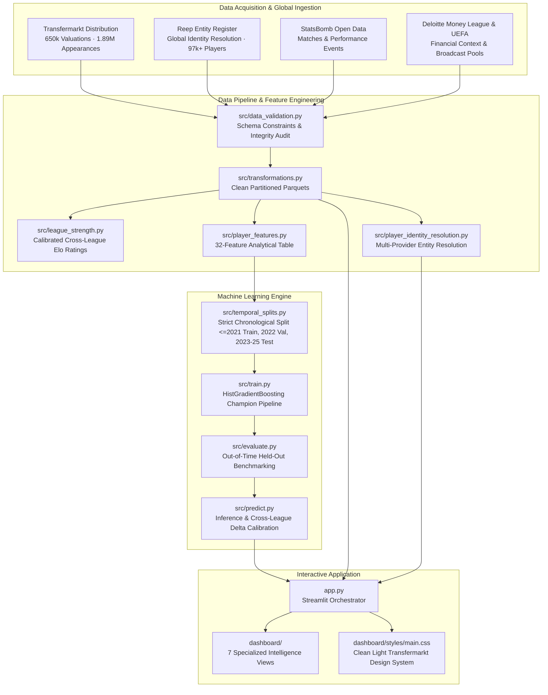

# TRANSFERA — The Global Football Market Intelligence Platform

<div align="center">

**THE GLOBAL GAME. DECODED.**  
*Player Valuations · Transfer Insights · League Analytics · AI-Powered Football Intelligence*

[](tests/)
[](https://www.python.org/)
[](models/)
[](app.py)
[](pyproject.toml)

</div>

---

## 1. Overview

**TRANSFERA** is a scientifically defensible, production-grade football market intelligence platform combining real-world match performance data with machine learning. Powered by a champion `HistGradientBoosting` model trained across verified leagues worldwide, it delivers:

* **Hero Transfer Value Predictor**: Instant valuation estimation for registered players, custom wonderkid simulations, and cross-league transfer moves.
* **Global Player Database Expansion**: Two-stage search engine indexing over **97,800+ verified footballers** across top European tiers, South America, Asia, and domestic competitions worldwide.
* **3-Tier Data Coverage Architecture**: Transparent, integrity-first classification (`Status A: Prediction Available`, `Status B: Limited Evidence`, `Status C: Profile Only`).
* **Calibrated Cross-League Strength Ratings**: Empirical Elo-based league intensity and financial power benchmarks across 65+ competitions.
* **High-Density Professional UI/UX**: Clean, light, Transfermarkt-inspired data presentation with signature aqua accents (`#02BFD0`).

---

## 2. System Architecture



---

## 3. Real Model Performance Summary

Evaluated on **12,408 held-out out-of-time test observations** (unseen 2023–2025 seasons):

| Metric | Baseline Median | Baseline Model A (Global) | Champion Model B (Context-Aware) | Improvement over Baseline |
| :--- | :--- | :--- | :--- | :--- |
| **MAE (€)** | €5,499,848 | €1,830,783 | **€1,775,860** (Val) / **€1,994,896** (Test) | **63.7% reduction** |
| **RMSE (€)** | €13,755,780 | €4,852,581 | **€4,668,612** (Val) / **€5,249,454** (Test) | **61.8% reduction** |
| **Median AE (€)** | €1,000,000 | €510,000 | **€443,019** (Test) | **55.7% reduction** |
| **R² Score** | -0.1453 | 0.8270 | **0.8399** (Val) / **0.8332** (Test) | **+0.9785** |

### Per-Competition Held-Out Test Results

| League Code | Competition Name | Country | Test Samples | Test MAE (€) | Test RMSE (€) | Test R² Score |
| :--- | :--- | :--- | :--- | :--- | :--- | :--- |
| **GB1** | Premier League | England | 1,035 | €5,955,962 | €10,101,561 | 0.7958 |
| **ES1** | LaLiga | Spain | 986 | €4,227,726 | €10,092,383 | 0.7631 |
| **IT1** | Serie A | Italy | 980 | €3,400,637 | €6,247,530 | 0.7796 |
| **L1** | Bundesliga | Germany | 851 | €3,259,844 | €6,524,884 | 0.8245 |
| **FR1** | Ligue 1 | France | 814 | €2,681,015 | €5,682,348 | 0.8281 |
| **NL1** | Eredivisie | Netherlands | 833 | €1,362,276 | €3,052,642 | 0.7399 |
| **PO1** | Liga Portugal | Portugal | 887 | €1,346,194 | €3,797,513 | 0.7834 |
| **BE1** | Jupiler Pro League | Belgium | 717 | €1,066,357 | €2,216,446 | 0.6440 |
| **TR1** | Süper Lig | Türkiye | 907 | €912,877 | €2,107,369 | 0.7291 |
| **RU1** | Premier Liga | Russia | 809 | €602,013 | €1,105,164 | 0.8754 |
| **GR1** | Super League 1 | Greece | 702 | €363,662 | €1,076,979 | 0.7650 |

---

## 4. Directory Structure

```
TRANSFERA/
├── app.py                            # Streamlit entry point & page router
├── config/
│   └── settings.py                   # Central paths, schema definitions, and constants
├── dashboard/
│   ├── components/                   # Reusable UI widgets (cards, charts, header, logo, sidebar)
│   ├── pages/                        # 7 feature pages: Home, Players, Leagues, Countries, Predictor, Comparison, Insights
│   ├── styles/                       # CSS design system (Transfermarkt clean light theme)
│   ├── data_service.py               # Optimized cached data access & two-stage search bridge
│   ├── prediction_service.py         # Champion model wrapper & cross-league simulation
│   └── global_player_profile.py      # Multi-provider player profile view
├── data/
│   ├── global/                       # Global player & competition catalog Parquet files (97k+ records)
│   ├── interim/                      # Cleaned entity parquets
│   ├── metadata/                     # Model metrics, coverage reports, and Elo ratings
│   ├── processed/                    # Feature table for inference & dashboard
│   └── raw/financial/                # League & club financial context benchmarks
├── docs/                             # Engineering documentation & methodologies
├── models/                           # Fitted HistGradientBoosting pipeline & comparison records
├── scripts/                          # Pipeline audit and validation utilities
├── src/
│   ├── connectors/                   # API-Football, Reep, and StatsBomb data connectors
│   ├── ingestion/                    # Raw data ingestion utilities
│   ├── coverage_manager.py           # 3-tier coverage assessment (Status A/B/C)
│   ├── evaluate.py                   # Out-of-time evaluation benchmarking
│   ├── global_player_search.py       # Two-stage search engine
│   ├── league_strength.py            # Elo ratings & continental match calibration
│   ├── player_features.py            # Feature engineering pipeline
│   ├── player_identity_resolution.py # Cross-provider entity resolution
│   ├── predict.py                    # Production prediction engine
│   └── train.py                      # Model tournament training pipeline
├── tests/                            # 59 automated test suites (pytest)
├── pyproject.toml                    # Build config and Ruff linter settings
├── requirements.txt                  # Python dependencies
└── README.md                         # Engineering documentation
```

---

## 5. Quickstart & Installation

### 1. Clone the Repository
```bash
git clone https://github.com/zaid-as-w/TRANSFERA.git
cd TRANSFERA
```

### 2. Set Up Virtual Environment
```bash
python -m venv .venv
# Windows:
.venv\Scripts\activate
# Linux/macOS:
source .venv/bin/activate
```

### 3. Install Dependencies
```bash
pip install -r requirements.txt
```

### 4. Launch the Interactive Platform
```bash
streamlit run app.py
```
Open [http://localhost:8501](http://localhost:8501) in your browser.

---

## 6. Testing & Code Quality

The codebase is covered by **59 automated tests** verifying connectors, data splits, feature schemas, coverage tiers, model predictions, and dashboard services:

```bash
# Execute full test suite
pytest -v

# Run Ruff linter
ruff check .
```

* All **59 tests pass cleanly**.
* Codebase adheres to zero warnings on `ruff check .`.

---

## 7. License & Credits

* Data sources: Open data from Transfermarkt distributions, Reep Entity Register, StatsBomb Open Data, Deloitte Football Money League, and UEFA financial reports.
* Developed for football market intelligence, scouting research, and algorithmic valuation modeling.
